# IT Asset & Service Desk

An IT portal for a small company's IT team. It tracks devices, software licences, network gear, cameras and vendors, handles IT requests and maintenance, and keeps an encrypted vault for shared passwords. Built in plain PHP and MySQL, and installable as a PWA.

## Features

- **Asset register:** devices, inventory, licences, network equipment, CCTV cameras and vendors, with asset tags, brand, model and serial numbers
- **QR asset labels:** printable labels for tagging hardware
- **Service desk:** IT requests and maintenance records with status tracking and resolution history
- **Expiry reminders:** a cron job (`cron_reminders.php`) emails alerts for licence, warranty and password-change dates
- **Password vault:** secrets are encrypted with AES-256-GCM; the key lives in a file outside the database, and a vault PIN is needed to reveal them
- **Access control:** a separate portal sign-in on top of the main system login, an explicit access list with roles, and an idle-timeout lock
- **Audit trail:** an activity log and a recycle bin for deleted records
- **Exports and email:** CSV export and PDF reports by email
- **Customisable:** sections and fields can be configured from the UI
- **Offline-ready PWA:** web manifest, service worker and offline page

## Screenshots

> Demo data only: made-up devices, people, IPs and serial numbers.

| Dashboard | IT inventory |
|---|---|
| 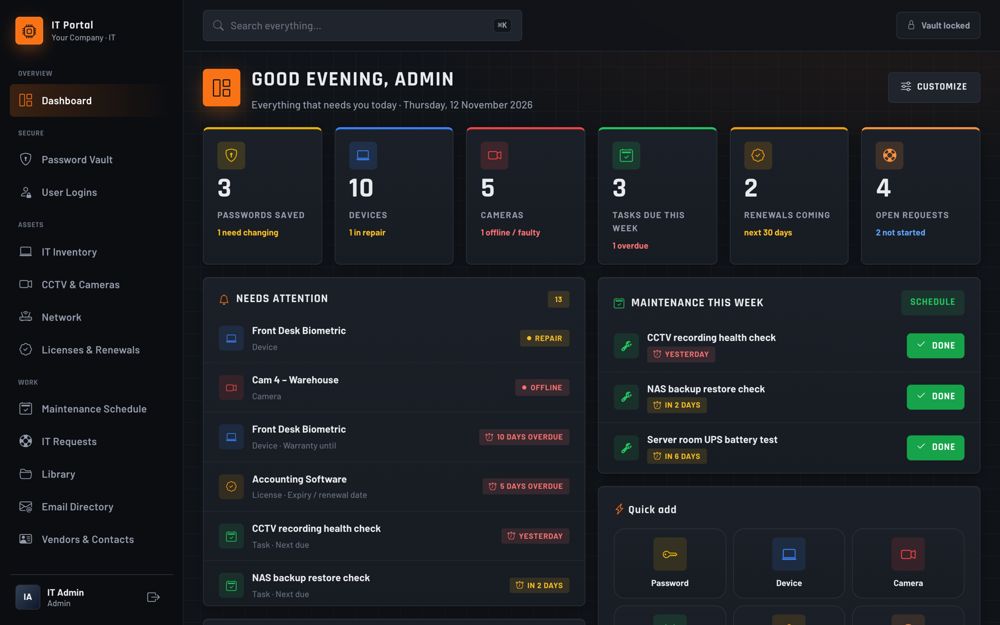 | 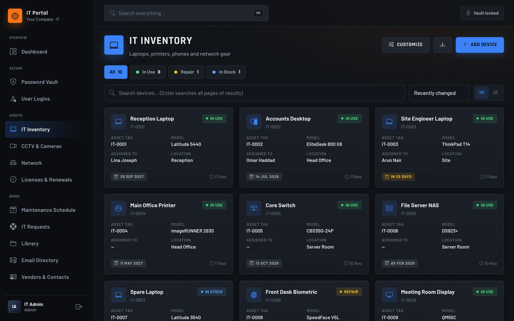 |
| **Device record** | **Licences & renewals** |
| 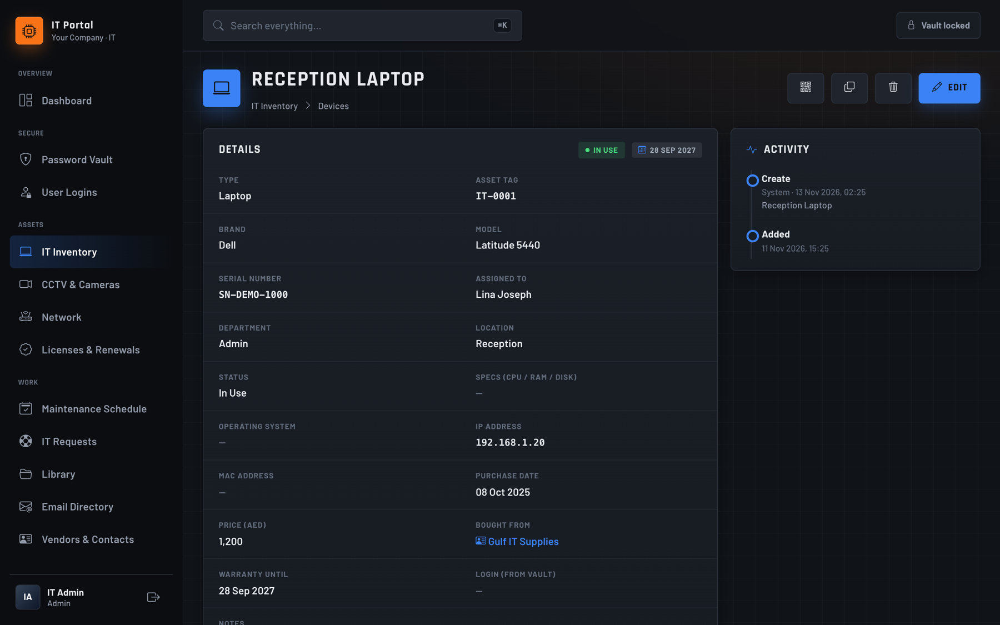 | 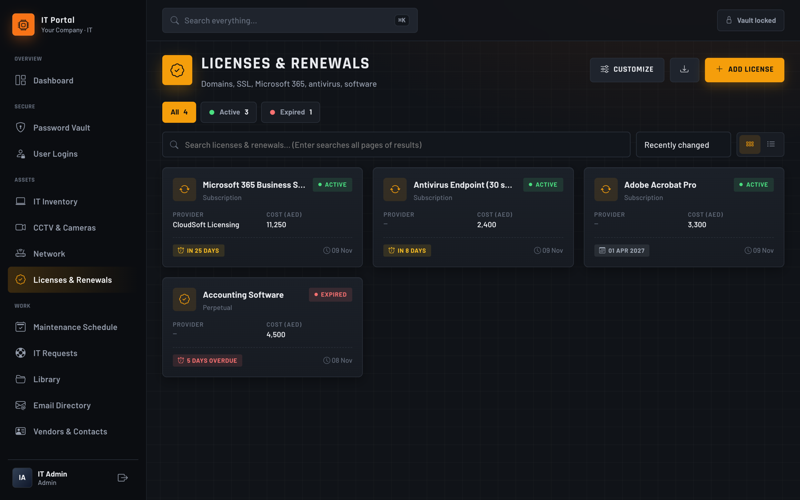 |
| **IT requests** | **CCTV & cameras** |
| 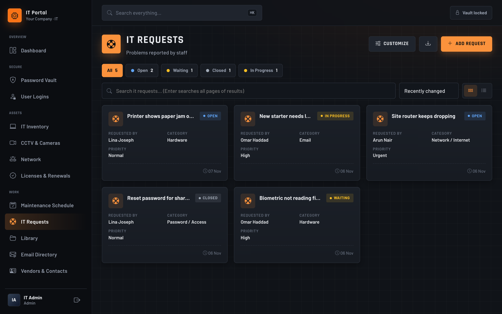 | 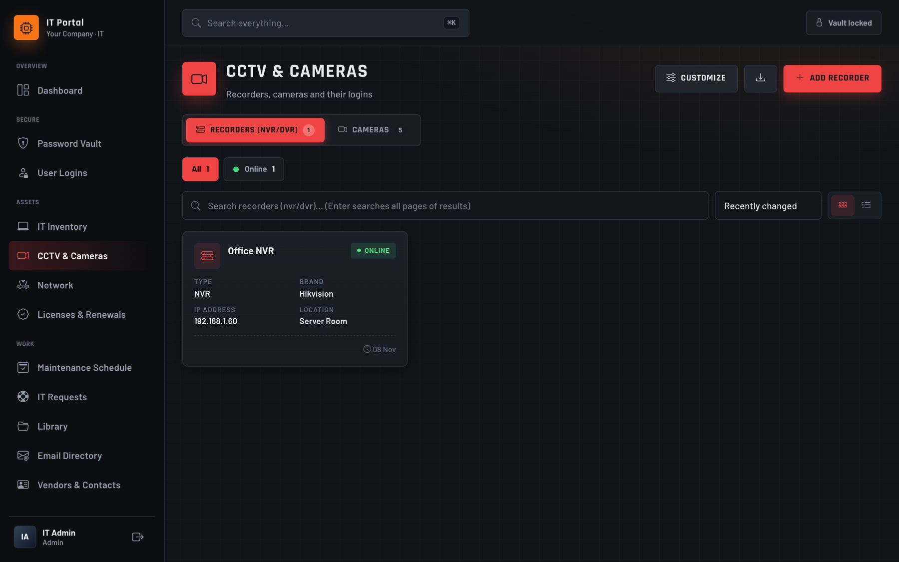 |
| **Maintenance schedule** | **Password vault (locked)** |
| 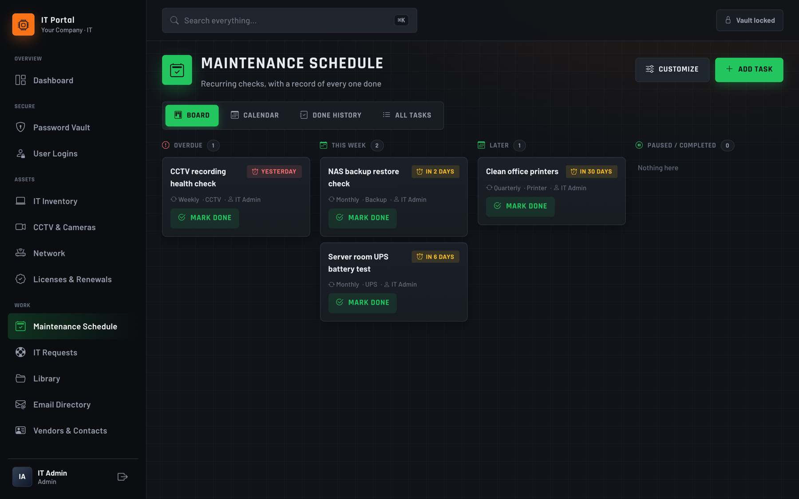 | 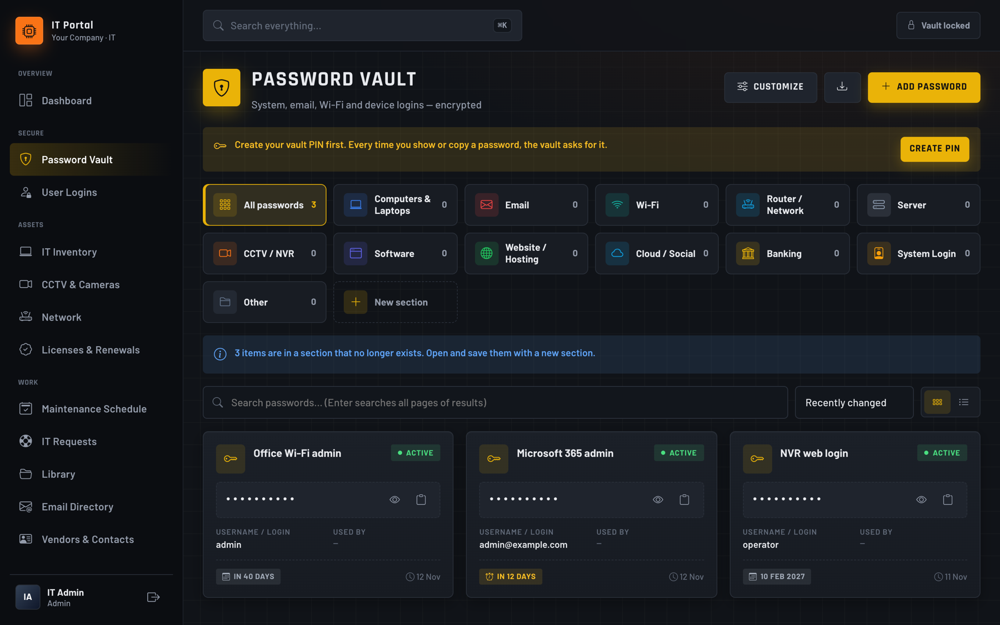 |
| **Activity log** | **Sign in** |
| 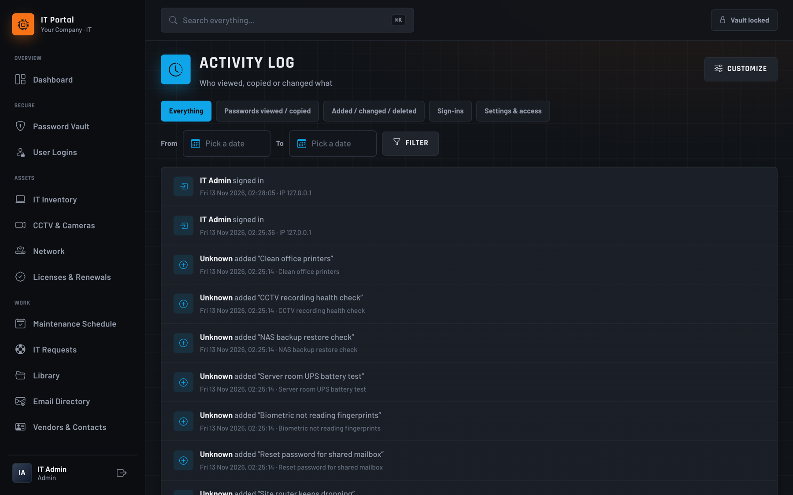 | 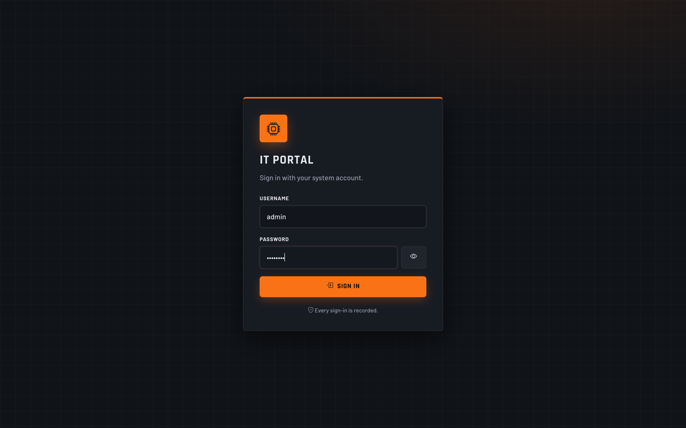 |

<p align="center">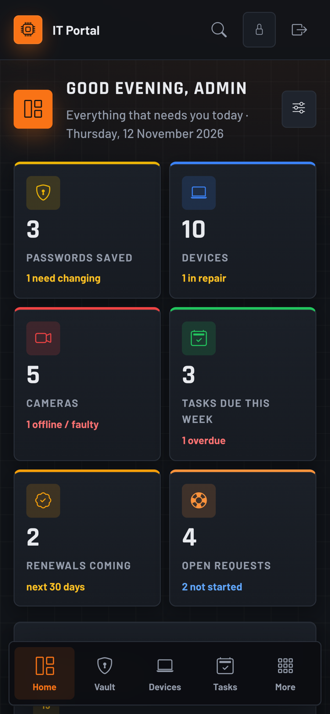<br><em>Installable PWA with a mobile layout</em></p>

## Tech

PHP 8 (PDO), MySQL, JavaScript, HTML5 and CSS3, OpenSSL (AES-256-GCM), and a service worker.

## Structure

```
*.php                 pages (dashboard, record, edit, settings, users, vault, ...)
includes/             core bootstrap, entity definitions, rendering, uploads
assets/               CSS, JS and icons
database/             MySQL schema (it_portal_tables.sql)
```

> This module was built to run inside a larger in-house business system. It expects that system's `includes/auth.php`, `includes/url_helper.php`, `includes/mailer.php` and its `user` table, which are not part of this repo.

## Author

**Anumon Jacob**: [Portfolio](https://aj-anumonjacob.github.io/Portfolio_Website/) · [LinkedIn](https://linkedin.com/in/anumonjacob)
